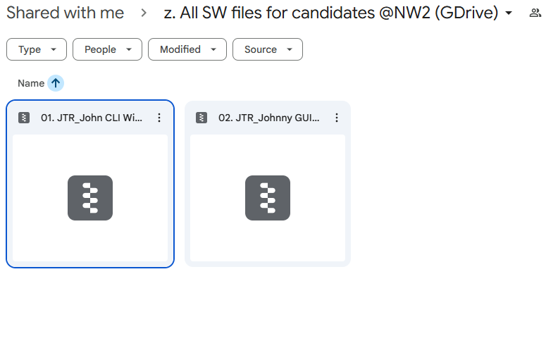
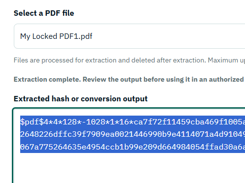
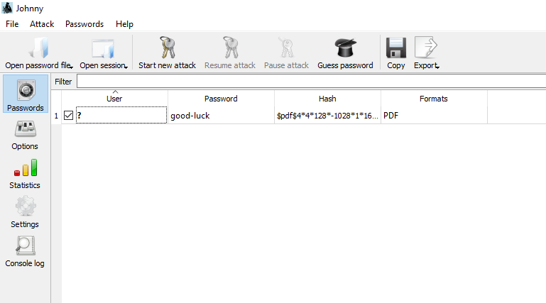
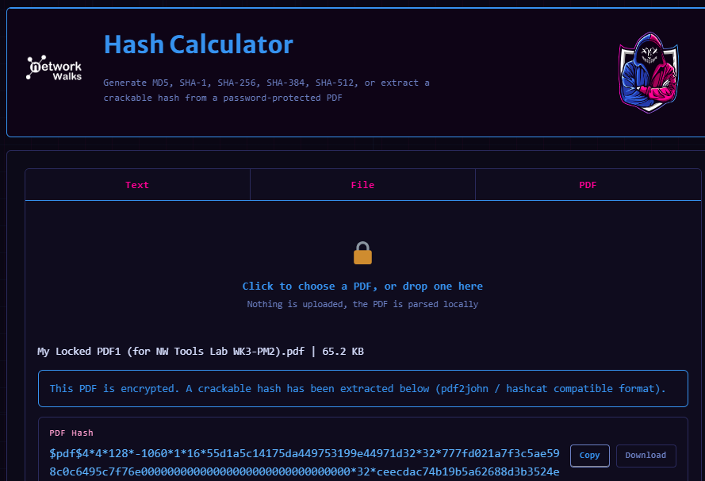
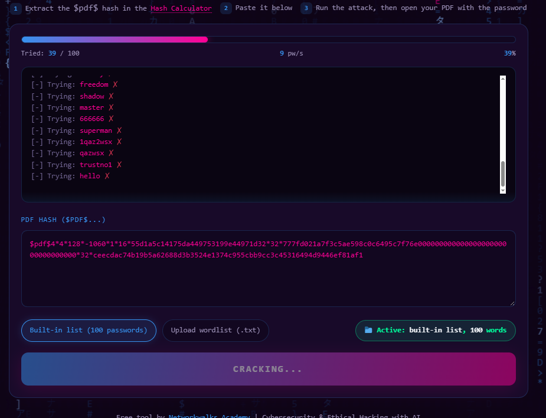
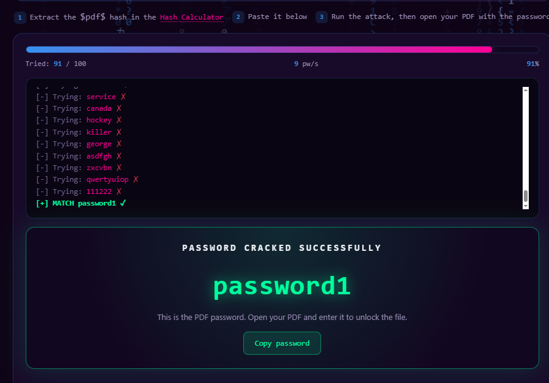

# Networkwalks-B084N-week3-Password-Cracking

## Password Cracking With JTR and NW Free Tool

## Tool-1: Password Cracking With John The Ripper

In this project, I cracked the password of a password-protected PDF 
file using John the Ripper (Johnny GUI).

## Tools Used
- John the Ripper
- Johnny (GUI for John the Ripper)
- Online PDF Hash Extractor tool

## Steps

1. Downloaded John the Ripper from its official website.
2. Downloaded Johnny GUI from its official website.

3. Opened this online PDF hash extractor tool:

   https://www.onlinehashcrack.com/tools-pdf-hash-extractor.php
5. Uploaded my PDF file and generated its hash value.
6. Copied the hash value.

6. Copied the hash value.
7. Opened Notepad and pasted the hash value into it.
8. Saved the file as `hash1.txt`.
9. Opened the Johnny application.
10. Clicked on "Open Password File".
11. Selected the `hash1.txt` file.
12. Clicked "Start New Attack" to begin the attack.
13. Waited a while (time depends on password complexity and PC speed) 
    until the password was cracked.

14. Used the cracked password to open the PDF file

## Tool-2: Password Cracking With Networkwalks Tools

## Tools Used
- Networkwalks Hash Calculator
- Networkwalks Password Cracker
- PDF Hashed File

## Steps

1. Open the Networkwalks Hash Calculator in your web browser:

https://networkwalks.com/hash-calculator/

2. Upload the locked PDF file to the Hash Calculator.

4. Copy the full hash value.

5. Open the Networkwalks Password Cracker in your web browser:

https://networkwalks.com/password-cracker/

5. Paste the hash value into the Password Cracker and start the attack. The tool will try different
passwords until it finds a match.

7. Wait for the tool to finish. The cracked password will be shown on the screen.
8. Open the locked PDF file and enter the cracked password.
9. Your PDF file will open.

